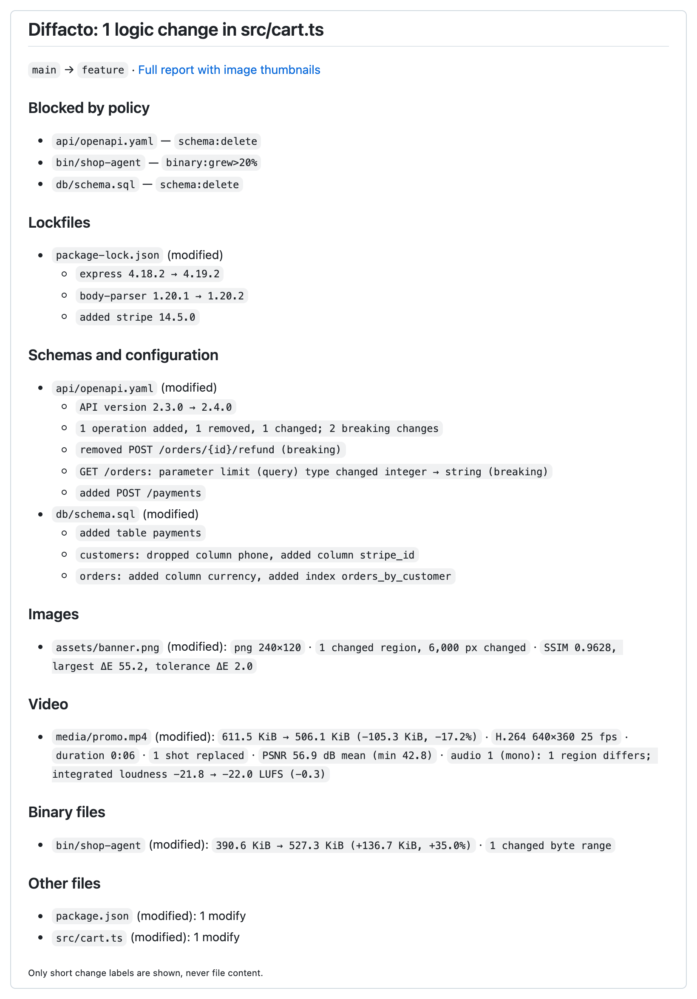
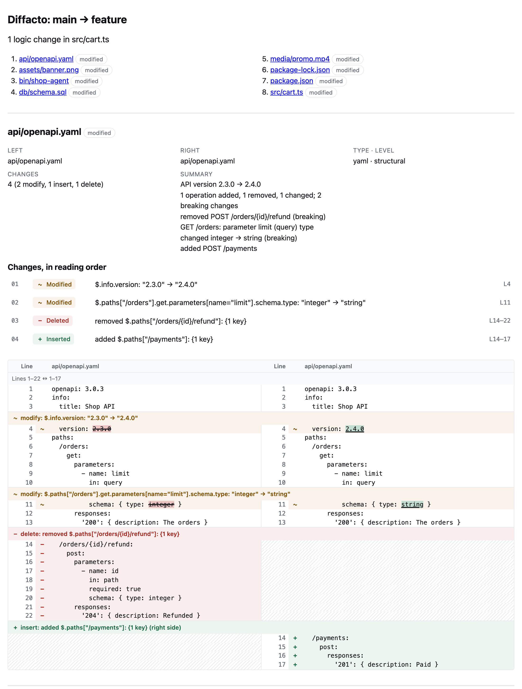
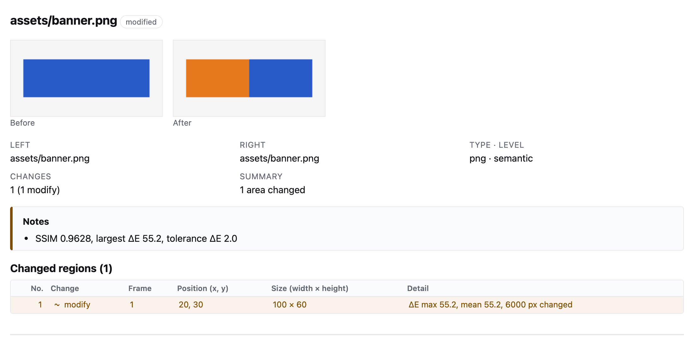

# Diffacto summary for pull requests

A GitHub Action that comments on a pull request with what it changes in the files a text diff shows badly: lockfiles, database and API schemas, images, binaries and video. The full report, with image thumbnails, is uploaded as a build artifact and linked from the comment. Only short change labels leave the runner, never file content.

It runs [Diffacto](https://diffacto.com/)'s `diffacto ci` command, downloaded from diffacto.com and checked against its published SHA-256 sums.

## Use it

```yaml
name: Diffacto
on: pull_request

permissions:
  contents: read
  pull-requests: write

jobs:
  summary:
    runs-on: ubuntu-24.04
    steps:
      - uses: actions/checkout@v4
      - uses: chauduyphanvu/diffacto-action@v1
```

The action fetches the history it needs to find where the pull request branched, so a default checkout is enough.

It runs on Linux (x64 and arm64, built for Ubuntu 24.04) and on macOS with Apple silicon. There is no Windows download yet; there, set `binary-url` to a `diffacto.exe` of your own.

## What it looks like

These pictures are real output from a sample pull request. It updates two npm packages and adds a third, removes an API endpoint, drops a database column, recolors part of a picture, blacks out and mutes a second of a video, and makes a program file bigger. The job ran with one rule set:

```yaml
      - uses: chauduyphanvu/diffacto-action@v1
        with:
          fail-on: schema:delete,binary:grew>20%
```

### The comment

<picture>
  <source media="(prefers-color-scheme: dark)" srcset="docs/comment-dark.png">
  20%). Then each changed file by kind: the lockfile's version changes, the API's breaking changes, the dropped and added columns, the picture's changed region, the video's replaced shot and changed sound, the program file's growth.">
</picture>

A new push updates the same comment instead of adding another. The job's summary page shows the summary too.

### When a rule blocks the pull request

The comment is posted first. Then the job's last step fails, and its log says which files the rules blocked:

```
diffacto: api/openapi.yaml is blocked by --fail-on schema:delete
diffacto: bin/shop-agent is blocked by --fail-on binary:grew>20%
diffacto: db/schema.sql is blocked by --fail-on schema:delete
```

### The full report

The comment links to the report, which is uploaded with the job. It shows every file in full. Here is the API file:

<picture>
  <source media="(prefers-color-scheme: dark)" srcset="docs/report-top-dark.png">
  
</picture>

And a picture, before and after:

<picture>
  <source media="(prefers-color-scheme: dark)" srcset="docs/report-image-dark.png">
  
</picture>

## Public and private repositories

Public repositories need no license. A private repository needs a Diffacto Team license: store the license key as a secret and give it to the job as `DIFFACTO_LICENSE`.

```yaml
jobs:
  summary:
    runs-on: ubuntu-24.04
    env:
      DIFFACTO_LICENSE: ${{ secrets.DIFFACTO_LICENSE }}
    steps:
      - uses: actions/checkout@v4
      - uses: chauduyphanvu/diffacto-action@v1
```

The key is checked on the runner and uses no seat.

## Inputs

| Input | What it does |
| --- | --- |
| `fail-on` | Rules that fail the job, after the comment is posted, when the pull request changes what they name. Comma-separated, no spaces, for example `schema:delete,lockfile:insert,binary:grew>10%`. |
| `language` | The language of the comment, the job summary and the report: `en` (the default), `de`, `ja` or `zh-Hans`. |
| `visual-baseline`, `visual-current` | Two folders of screenshots in the checkout. With both, the screenshots are checked against the baseline too, and get a comment of their own. |
| `post` | `false` to skip the comment. The summary is still on the job's page. |
| `version` | The Diffacto release to install. The newest by default. |
| `base` | The commit or branch the pull request merges into. By default, the pull request's base. |
| `fetch-depth` | How many commits to fetch when the checkout is too shallow to see where the pull request branched. 100 by default. |
| `report-artifact` | The name of the uploaded artifact. `diffacto-report` by default. |
| `github-token` | The token that posts the comment. The job's own by default. |
| `release-url`, `binary-url` | Where to download Diffacto from instead. A download from another address is not checked. |

`action.yml` describes each in full.

## Outputs

| Output | What it is |
| --- | --- |
| `summary` | The path of the `summary.json` this run wrote. |
| `report-url` | Where the uploaded report can be opened. |
| `visual-changed` | Whether any screenshot changed: `true` or `false`, empty when screenshots weren't checked. |

## Pull requests from forks

A pull request from a fork gets a read-only token, so the comment is skipped and the summary is on the job's summary page.

## Versions

`@v1` follows the newest 1.x release. Each Diffacto release tags this repository with its own version too, such as `@v1.2.0`, for those who pin one.
